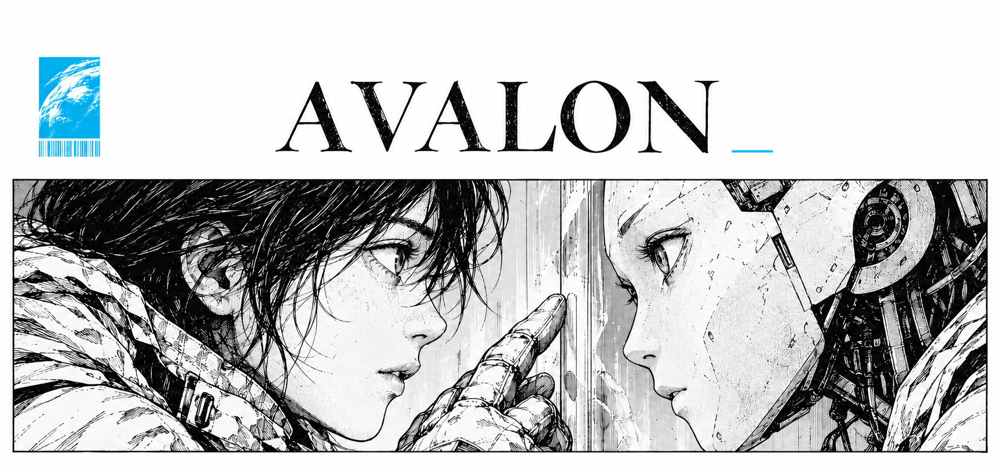

<p align="center">
  
</p>

<h1 align="center">Build the worlds that shape machine intelligence.</h1>

<p align="center">
  <a href="#install">Install</a> ·
  <a href="#use-it-with-your-agent">Commands</a> ·
  <a href="#evidence-and-limits">Evidence</a>
</p>

Avalon adds reinforcement learning workflows to Codex, Claude Code, and Cursor.
Use your agent to build environments and run training experiments within a declared budget.
The local CLI and TypeScript SDK audit recorded experience and save counterexamples.

## Install

Use Node.js 22.12 or later and npm. Run this command in your project directory:

```sh
npx --yes https://github.com/marco-trotta1/avalon-rl/releases/latest/download/avalon.tgz install codex
```

Replace `codex` with `claude` or `cursor` for another agent.
Add `--dry-run` to preview the installation or `--project PATH` to select a project.
The installer uses a project runtime and preserves customized skills.

## Use it with your agent

Claude Code and Cursor use slash commands. In Codex, open `/skills` or use names such as `$rl-break`.

```text
/avalon Diagnose why reward rises while task completion falls
/rl-env Build an environment for this task
/rl-break Find a rewarded failure in this environment
/rl-train Compare the original and revised rewards
```

Your coding agent supplies the model and tools. It follows the host's permissions and budget.
See all [23 workflows](docs/agent-commands.md) for inputs, outputs, and execution limits.

<details>
<summary>Run a local demo without a model</summary>

Run these commands from a directory that does not contain an `avalon-rl` folder:

```sh
git clone https://github.com/marco-trotta1/avalon-rl.git
cd avalon-rl
npm ci --ignore-scripts
npm run build
node dist/cli.js world-run --data examples/world/claim-plan.json
```

The demo exposes a false completion claim in a synthetic invoice task.
It makes no model calls.

</details>

## Guides

| Task | Guide |
| --- | --- |
| Build tasks and test rewards | [World rules](docs/world.md) |
| Audit a data pipeline | [CLI reference](docs/cli.md) · [Snapshot format](docs/snapshots.md) |
| Train with Gymnasium or use Minari | [Python setup](docs/python-lab.md) |
| Use the SDK | [TypeScript SDK](docs/sdk.md) |
| Follow the experiments | [RL walkthrough](docs/learn-rl.md) |

## Evidence and limits

The published experiments use synthetic tasks.
They do not establish production detection rates or general training gains.
Read the [policy results](docs/wave2/results.md) and [pipeline results](experiments/python-counter-results.md) for baselines, costs, and negative findings.

Keep raw snapshots and witnesses private.
Read the [security guide](SECURITY.md) before sharing evidence.

[Contribute](CONTRIBUTING.md) · [MIT License](LICENSE)

